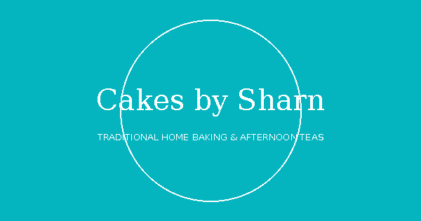

# Cakes by Sharn — website

A responsive, dependency-free website for **Cakes by Sharn**, based on the logo, menu and social links supplied by the business.



## What's included

- Mobile-friendly landing page with the existing turquoise branding
- Afternoon teas, loaves, traditional bakes, cupcakes and celebration cakes
- Menu filters and an interactive **order enquiry builder**
- Editable quantities, optional customer details and a copy-to-clipboard enquiry
- Direct links to Instagram and Facebook
- Original supplied logo and menu for reference, plus original SVG illustrations
- Basic SEO, Open Graph metadata, keyboard-friendly mobile navigation and enquiry drawer
- No framework, accounts, dependencies, build step or server-side checkout required

**Important:** An enquiry is not a placed or confirmed order. The website does not take payments, send messages on the customer's behalf, guarantee stock or track orders. Customers copy their enquiry and paste it into Instagram or Facebook to contact Sharn.

## Quick preview

Open `index.html` in your browser. Alternatively, from this folder run:

```bash
python3 -m http.server 8000
```

Then visit `http://localhost:8000`.

## Publish on GitHub Pages

This zip includes a full Git repository on the `main` branch. To upload it to your own GitHub account:

1. Extract `cakes-by-sharn-git-repo.zip` and open a terminal inside the extracted `cakes-by-sharn` folder.
2. On GitHub, create a new **empty** repository named `cakes-by-sharn` (do not initialize with a README or `.gitignore`).
3. Connect the local repository to your new GitHub repository and push:

```bash
git remote add origin https://github.com/YOUR-USERNAME/cakes-by-sharn.git
git push -u origin main
```

4. On GitHub, go to **Settings → Pages → Build and deployment**. Choose **Deploy from a branch**, then select the `main` branch and `/ (root)` folder. Save.
5. GitHub Pages will publish the static website. No build command is needed.

Alternatively, upload the **contents** of the extracted directory (excluding `.git`) to a new GitHub repository using the GitHub web interface. The included Git history is preserved only with the terminal-based push.

## Other hosts

- **Netlify:** Connect the GitHub repository or drag the extracted site files into the deploy interface. No build command is needed; publish the root folder.
- **Vercel:** Import the GitHub repository, choose the **Other** framework preset, and use the root directory for deployment. No build command or compiled output directory is required.
- **Any static web host:** Upload `index.html`, `styles.css`, `app.js` and the entire `assets/` directory, keeping the same paths.

## Updating the site

| Change | File |
| --- | --- |
| Menu items and prices | `app.js` → `MENU` constant near the top |
| Instagram / Facebook | `index.html` (search for `cakesbysharnx`) |
| Text, sections and buttons | `index.html` |
| Colours, fonts and layout | `styles.css` (`:root` variables at top) |
| Brand logo | `assets/cakes-by-sharn-logo.jpg` |
| Illustrations | `assets/*.svg` |
| Original supplied menu | `assets/original-menu.jpg` (reference only) |

Menu entries accept `priceType: 'fixed'`, `'from'` or `'quote'`:

```js
{ name: 'Banana loaf', price: 5, priceType: 'fixed' }
{ name: '7-inch buttercream cake', price: 45, priceType: 'from' }
{ name: 'Personalised cupcakes', priceType: 'quote' }
```

The enquiry basket stores product selections in the customer's browser using `localStorage`. Names, preferred dates and other details entered in the enquiry form are not stored or transmitted by the website.

## Before the public launch

The attached source menu was supplied as an image and could be out of date. **Ask Sharn to confirm every price and product** before publishing. The site purposely does not invent an address, delivery area, food hygiene rating, opening hours, email, phone number or allergy assurances. Add these only after the business confirms them.

The site uses **illustrations, not photographs of Cakes by Sharn's products**. Replace or complement the artwork with the business's own cake photographs whenever they're available.

For reliable social preview images, update the `og:image` meta tag in `index.html` to the **absolute HTTPS URL** of the deployed `assets/social-preview.png` image once the domain is known. You can also update the page description and add any verified business details.

Fonts are requested from Google Fonts; the site includes system font fallbacks and remains usable without the font service. No analytics or tracking scripts have been added.

## File structure

```text
cakes-by-sharn/
├── .git/                    # Initial Git history (included in repo ZIP)
├── .gitignore
├── index.html               # Content and accessible markup
├── styles.css               # Responsive site styles
├── app.js                   # Menu, filters and enquiry builder
├── robots.txt
├── README.md
└── assets/
    ├── cakes-by-sharn-logo.jpg
    ├── original-menu.jpg
    ├── hero-cake.svg
    ├── celebration-cake.svg
    ├── afternoon-tea.svg
    ├── loaf.svg
    ├── brownies.svg
    ├── cupcakes.svg
    ├── favicon.svg
    ├── social-preview.svg
    └── social-preview.png
```

## Social links

- Instagram: https://www.instagram.com/cakesbysharnx/
- Facebook: https://www.facebook.com/cakesbysharnx/

Both are taken directly from the supplied links.

## Ownership

This starter site was made specifically for Cakes by Sharn. Business logos, images and written materials remain the property of their respective owners. No third-party product photos or testimonials have been introduced.
